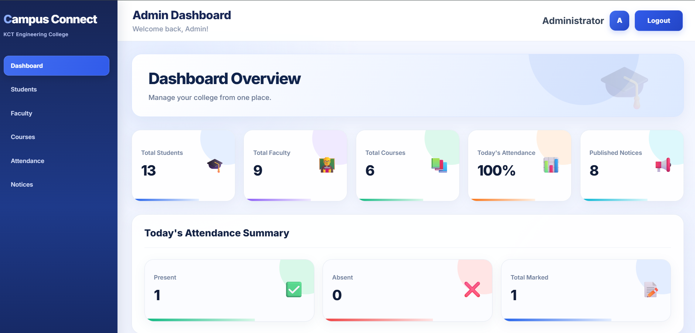

# CampusConnect

### College Management System \| KCT Engineering College

CampusConnect is a web-based college management system that brings
common administrative tasks into one place. The admin area supports
student and faculty records, courses, attendance, notices, and a
dashboard with summary statistics.

**Live application:** https://campus-connect-swart-omega.vercel.app/\
**Backend service:** https://campus-connect-0hr7.onrender.com\
**Source code:** https://github.com/mohammed-saqeeb1312/Campus-Connect

## Features

-   Admin login with JWT-based authentication
-   Dashboard summary for students, faculty, courses, notices, and
    attendance
-   Student record management
-   Faculty record management
-   Course management
-   Attendance marking and updates
-   College notice management

Administrative features require a valid admin login. Do not publish
admin credentials.

## Technology stack

  Area              Technologies
  ----------------- -------------------------------------
  Frontend          React, Vite, JavaScript, CSS
  Backend           Node.js, Express.js
  Database          MongoDB Atlas, Mongoose
  Authentication    JSON Web Token (JWT), bcryptjs
  API testing       Postman
  Version control   Git, GitHub
  Deployment        Vercel (frontend), Render (backend)

## Project structure

``` text
Campus-Connect/
├── client/                 # React + Vite frontend
│   ├── public/
│   └── src/
│       ├── components/
│       └── pages/
├── server/                 # Express backend
│   ├── config/             # Database connection
│   ├── controllers/        # Application logic
│   ├── middleware/         # Authentication and error handling
│   ├── models/             # Mongoose models
│   ├── routes/             # API routes
│   └── scripts/
└── .gitignore
```

## Run locally

### Requirements

-   Node.js and npm
-   MongoDB Atlas database (or another MongoDB connection)
-   Git

### 1. Clone the repository

``` bash
git clone https://github.com/mohammed-saqeeb1312/Campus-Connect.git
cd Campus-Connect
```

### 2. Install and configure the backend

``` bash
cd server
npm install
```

Create `server/.env`:

``` env
MONGO_URI=your_mongodb_connection_string
JWT_SECRET=your_long_random_secret
PORT=5000
```

Keep the real `.env` file private. Never commit database credentials,
JWT secrets, or admin passwords.

Start the backend:

``` bash
npm start
```

The local backend normally runs at `http://localhost:5000`.

### 3. Install and run the frontend

Open a second terminal:

``` bash
cd client
npm install
npm run dev
```

Vite will show the local frontend address, usually
`http://localhost:5173`. Make sure the frontend API base URL points to
the local backend during local development and to the Render backend
when deployed.

## API overview

  Module           Base route          Main operations
  ---------------- ------------------- ------------------------------
  Authentication   `/api/auth`         Admin login
  Students         `/api/students`     Create, read, update, delete
  Faculty          `/api/faculty`      Create, read, update, delete
  Courses          `/api/courses`      Create, read, update, delete
  Attendance       `/api/attendance`   Mark, view, update
  Notices          `/api/notices`      Create, read, update, delete
  Dashboard        `/api/dashboard`    Dashboard statistics

Protected endpoints require a valid JWT:

``` http
Authorization: Bearer <your_token>
```

Use Postman to test the API. Never share real tokens, passwords, or
private database values.

## Screenshots

Add approved screenshots to `docs/screenshots/` and link them here.
Suggested images:

1.  `login.png` -- login page, with no credentials visible.
2.  `dashboard.png` -- dashboard with sample or anonymised data.
3.  `students.png` -- student management page.
4.  `faculty.png` -- faculty management page.
5.  `courses.png` -- course management page.
6.  `attendance.png` -- attendance page.
7.  `notices.png` -- notice management page.
8.  `postman-students-get.png` -- successful GET request and response.
9.  `postman-students-post.png` -- successful POST request and response.
10. `postman-auth-login.png` -- successful login response, with the
    token hidden.

Example image link after adding a screenshot:

``` md

```

## Testing checklist

Before sharing a release, test: - Admin login and logout - Dashboard
statistics - Student, faculty, and course operations - Attendance
creation and updates - Notice operations - Protected pages after
logout - Desktop and mobile layouts

Use sample data for demonstrations. Avoid exposing real student personal
information.

## Deployment

-   **Frontend:** Vercel
-   **Backend:** Render
-   **Database:** MongoDB Atlas

Production configuration is provided through environment variables in
the hosting providers. Local `.env` files should not be committed to
GitHub.

## Future improvements

Potential additions include separate faculty and student accounts,
timetable and examination modules, fee management, downloadable reports,
and notifications.

## Project

Developed as a full-stack college management project for KCT Engineering
College.

For issues or suggestions, open an issue in this repository.
